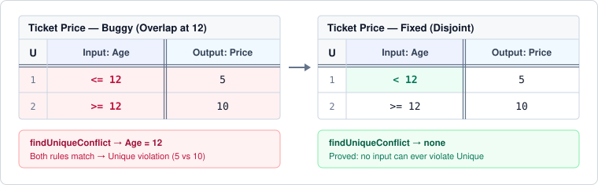
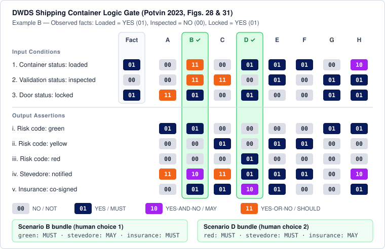

# Maize

Maize is a [Lean 4](https://lean-lang.org) library that gives decision tables and tabular logic gates a unified denotational semantics, and uses it to verify tables for overlapping or conflicting rules before they run. Both [DMN](https://www.omg.org/dmn/) (OMG's industry standard for business decision tables) and [DWDS](https://xalgorithms.org/) (Joseph Potvin's Data With Direction Specification for expressing laws, policies, and contracts as data) are derived as instances of a single core model.

---

## Why Formalise Decision Tables?

A decision table encodes conditional logic as a grid instead of nested `if`/`then` statements. Even a two-rule table can hide an overlap (`<= 12` vs. `>= 12`), where an age of `12` matches both rules and produces two conflicting prices. In multi-column tables over unbounded integers and strings, exhaustive unit testing is impossible.

Formalising the semantics in Lean gives three guarantees that testing cannot:


1. **Sound and complete conflict search:** Any input Maize reports genuinely triggers a conflict, and returning `none` proves no input in the modelled domain can trigger one.
2. **Verified evaluators:** Maize's executable evaluators are proved to agree with the mathematical specification.
3. **Safe transformations:** Reordering clauses, removing duplicates, merging tables, renaming columns (onto), and translating between logics are proved to preserve the per-assertion semantics.

---

## Architecture

Maize separates the general theory of tabular logic from format-specific syntax.

### 1. The Core Semantics ([`Maize/Core.lean`](Maize/Core.lean))

A table is modelled as a list of clauses. Each clause specifies what it expects for every input condition and what it asserts for every output. Given a set of observed facts, a clause fires when every one of its input conditions matches the corresponding fact.

To plug a rule format into Maize, you only define five things: what input cells look like, what observed facts look like, what output values look like, when an input cell matches a fact, and which output value means "nothing asserted."

Once the matching clauses fire, Maize reads the result in two ways:
- **Bundled outcomes:** Keeps each firing clause's complete set of outputs together as a unit. If two firing clauses produce different output bundles, the table leaves a choice to resolve.
- **Per-assertion view:** Looks at one output at a time, ignoring "nothing asserted" cells. Every output is proved to be in exactly one of three states: silent (no clause asserts anything), determinate (exactly one value is asserted), or deferred (two firing clauses assert different values).

### 2. Conflict Search

Rather than guessing test inputs, Maize proves that every conflict or choice comes from a pair of clauses that can fire at the same time, and that co-firing can be checked independently condition by condition.

A format only needs to supply one small helper that takes two input cells and returns a single fact accepted by both (or `none` if they can never overlap). Plugging that helper into the core automatically gives sound and complete search for both per-assertion conflicts and whole-bundle choices.

### 3. Nomenclature / Functional Map

| Maize (`Core.lean`) | DMN (`DMN.lean`) | DWDS (`DWDS.lean`) |
| :--- | :--- | :--- |
| Table | Decision table | Logic gate |
| Clause | Rule (row) | Scenario (column) |
| Condition | Input column | Input condition |
| Assertion | Output column | Output assertion |
| Expected state | Cell test (comparisons, ranges, lists) | Scenario element (`00`, `01`, `10`, `11`) |
| Observed state | Input value (integer, string, boolean) | Sieve element (`Fact`: `yes`, `no`) |
| Output mode | Output value (or none) | Normative mode (`NOT`, `MUST`, `MAY`, `SHOULD`) |
| Absent mode | Empty output (`none`) | `NOT` (`00`) |
| Bundled outcomes | Matching output rows | Invoked scenario bundles |
| Choice | Disagreeing matching rows | Decision left to the rule-taker |
| Hit policy | `unique`, `any`, `first`, `collect`, `ruleOrder` | None (all matching scenarios kept) |

---

## Instances and Examples

### DMN ([`Maize/DMN.lean`](Maize/DMN.lean))

Decision Model and Notation (DMN) is the standard format for business decision tables. Each column is an input or an output, and each row is a rule. Input cells hold simple tests over integers, strings, or booleans (such as an exact value, `<= 12`, a range like `[12..64]`, a list of allowed values, or `-` for "any value").

Because more than one row can match the same input, every DMN table declares a **hit policy** to pick the final answer:
- **Unique (`U`):** At most one row may match; multiple matches cause a violation.
- **Any (`A`):** Multiple rows may match only if they produce the exact same outputs; otherwise it is a violation.
- **First (`F`):** Take the first matching row from the top.
- **Collect (`C`) / Rule Order (`R`):** Return all matching outputs.

To search for overlaps over infinitely many integers and strings, Maize normalises each cell test into an interval or value list and intersects them column by column.




- **Finding a bug:** On the buggy ticket table (`<= 12` vs. `>= 12`), Maize extracts age `12` and proves that evaluation under `unique` fails with a violation.
- **Proving the fix:** Changing `<= 12` to `< 12` makes the search return `none`, proving that no input can ever cause a violation.
- **Catch-all rules:** Adding a trailing wildcard (`-`) rule of `8` shows that a catch-all acts as an "else" only under `first`. Under `unique` and `any` it causes a violation wherever it overlaps an earlier rule, and under `collect` it fires alongside earlier matches.

### DWDS ([`Maize/DWDS.lean`](Maize/DWDS.lean))

The [Data With Direction Specification](https://gitlab.com/xalgorithms-alliance/data-with-direction-specification/dwds-documents/-/tree/master/current) (detailed in Joseph Potvin's 2023 DBA thesis) is a tabular format for expressing laws, policies, and contracts as data. In DWDS, a rule contains a vertical logic gate whose columns are **scenarios**.

Maize models the logic gate's sifting stage (§5.3.9, §5.5.3), abstracting away natural-language sentence structure, arithmetic/lookups, and network metadata. Each cell in a scenario uses a two-bit code:

| Code | Input Condition Cell | Output Assertion Mode |
| :--- | :--- | :--- |
| `00` | `NO` | `NOT` (not invoked) |
| `01` | `YES` | `MUST` |
| `10` | `YES-AND-NO` (both) | `MAY` |
| `11` | `YES-OR-NO` (unsure) | `SHOULD` |


- **Matching facts:** Following the worked examples in §5.5.3 (Figures 30 and 31), sieve elements (observed facts) are modelled as `YES`/`NO` (`Fact`). `YES` matches `YES`, `NO` matches `NO`, and `YES-AND-NO` / `YES-OR-NO` match either.
- **Output modes:** In full DWDS, each output assertion is a declarative sentence (which can carry text, numbers, or formulas). In each scenario, that sentence's cell gives a normative mode (`NOT`, `MUST`, `MAY`, or `SHOULD`). Maize abstracts over the sentence text to model the mode-level logic.
- **A decision for the rule-taker instead of hit policies:** DWDS does not discard matching scenarios. Every matching scenario produces a complete bundle of output modes; when two matching scenarios produce different bundles, the decision is left to the rule-taker (human or machine).

#### Example: Shipping Container Gate (Potvin 2023, Figures 28, 30, 31)




- **Figure 30:** Not loaded, inspected, not locked invokes only Scenario C, with no decision for the rule-taker.
- **Figure 31:** Loaded, not inspected, locked invokes both Scenarios B and D. Maize keeps them as two separate bundles (`green: MUST, stevedore: MAY, insurance: MUST` vs. `red: MUST, stevedore: MUST, insurance: MAY`), preserving the decision for the rule-taker.
- **Undocumented choice point:** Automated search discovers a choice point not discussed in the thesis: not loaded, not inspected, and locked invokes both Scenarios A and B (`exampleAB`, `container_choice`). The search also finds per-assertion conflicts: stevedore (A against B) and insurance (B against D, in Figure 31).
- **Catch-all scenarios:** Appending a catch-all `YES-OR-NO` scenario for a yellow light does not act as an "else." It fires alongside Scenarios B and D, adding a third bundle.

---

## Headline Theorems

The general theorems hold for every table and every input in the modelled domain, which no finite test suite can establish.

| Theorem | Guarantee |
| :--- | :--- |
| `Table.trichotomy` | Every output assertion is either silent, determinate, or deferred. |
| `Table.mem_outcomes` | The executable evaluator produces the exact output bundles defined by the denotational semantics. |
| `Table.ought_iff_produces` / `choice_of_deferred` | The per-assertion view is read off the bundles, and every per-assertion conflict is a choice. |
| `Table.findConflict_sound` / `findConflict_none` | Per-assertion conflict search is sound and complete. |
| `Table.findChoice_sound` / `findChoice_none` | Whole-bundle choice search is sound and complete. |
| `Table.Deferred.of_refines` | Replacing vague observations with more precise ones never creates new deferrals. |
| `Table.ought_perm` / `ought_append` / `ought_comap` | Reordering clauses, merging tables, and surjective column renaming preserve per-assertion semantics (order-dependent policies like DMN `first` can still depend on order). |
| `Table.not_decisive_of_catchAll` | A catch-all clause that disagrees with any reachable clause always creates a conflict. |
| `DMN.findUniqueConflict_sound` / `findUniqueConflict_none_never_violates` | DMN `unique` conflict search is sound and complete; `none` guarantees no input ever violates `unique`. |
| `DMN.eval_any_ne_violation` | A decisive DMN table with filled output rows never violates `any`. |
| `DMN.eval_first_catchAll` | Under DMN's `first` policy, a catch-all at the end of a table acts as an "else." |
| `DWDS.ought_toDWDS` | DWDS is a conservative extension of ordinary Boolean decision tables on `YES`/`NO` facts. |
| `DMN.ticketFixed_never_violates`, `DWDS.exampleA`, `exampleB`, `exampleAB` | Concrete verified tables: universal safety of the fixed ticket table, reproduction of Figures 30 and 31, and the A/B choice point. |

---

## Out of Scope


- **DMN:** Negated tests (`not(...)`), decimals, dates/times, `null` inputs, `priority` and `output order` hit policies, `collect` aggregations, default outputs, and whole-row `collect`/`ruleOrder` results for multi-output tables (currently returned per column).
- **DWDS:** Four-valued observed facts (`YES-AND-NO` / `YES-OR-NO` in `[is.dwd]`), RuleReserve `in effect` and `applicable` metadata sifting, natural-language sentence syntax, arithmetic/lookup evaluation, and multi-table pipelines.
- **Parsing:** Tables are written directly in Lean rather than parsed from DMN XML or `.dwd` JSON/CBOR files.

---

## Building

Requires [Lean 4](https://lean-lang.org) (via `elan`) and [Mathlib](https://github.com/leanprover-community/mathlib4):

```bash
lake exe cache get
lake build
```

## Notes

I designed the model, its semantics and abstractions, proved few core proofs, and reviewed every definition and theorem statement. Claude and Gemini drafted most of other Lean proofs and documentation. All proofs are checked by the Lean kernel.


## Contact

Irfan Ali | [irfan@irfanali.org](mailto:irfan@irfanali.org)
